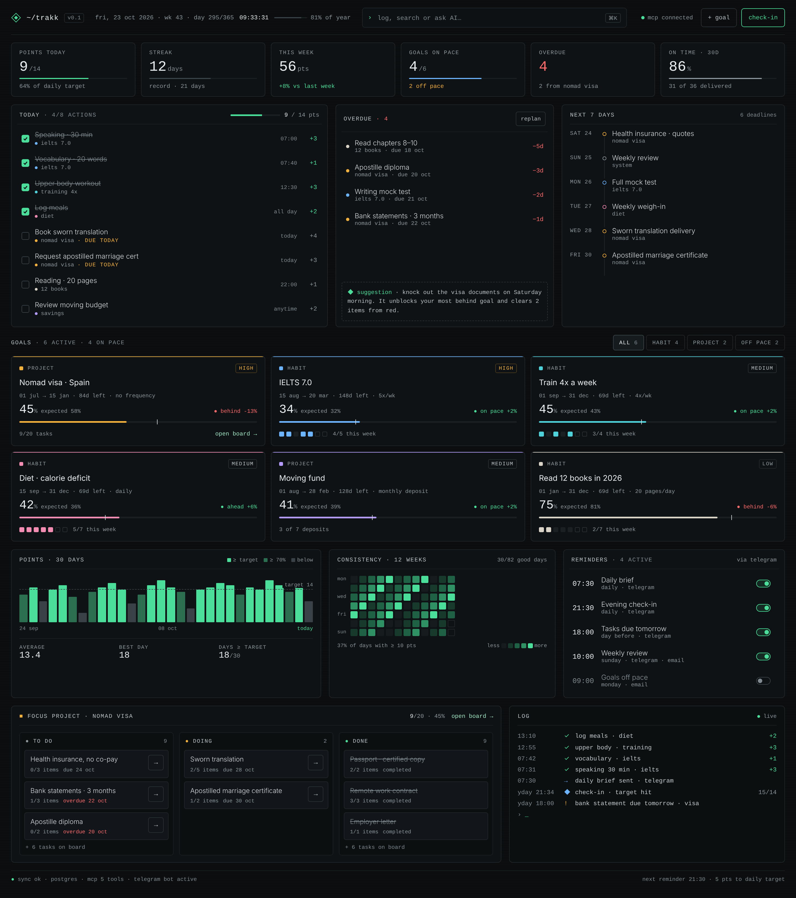

# Trakk

Personal goal tracker: goals, daily actions worth points, pace against deadlines, a dense dark dashboard, Telegram reminders and an MCP server for Claude.



## Docs

- [Product](docs/PRODUCT.md): scope, glossary, business rules
- [Architecture](docs/ARCHITECTURE.md): stack, layers, data model, MCP, reminders
- [Design](docs/DESIGN.md): tokens, components, layout; prototypes in `docs/design/prototype/`
- [Roadmap](docs/ROADMAP.md): milestones and setup steps
- [Deploy](docs/DEPLOY.md): VPS plan
- [CLAUDE.md](CLAUDE.md): instructions for coding agents

## Local development

Requires PHP 8.4, Composer, Node 22+, PostgreSQL 17.

```bash
composer install && npm install
cp .env.example .env && php artisan key:generate
php artisan migrate --seed
composer run dev
```
